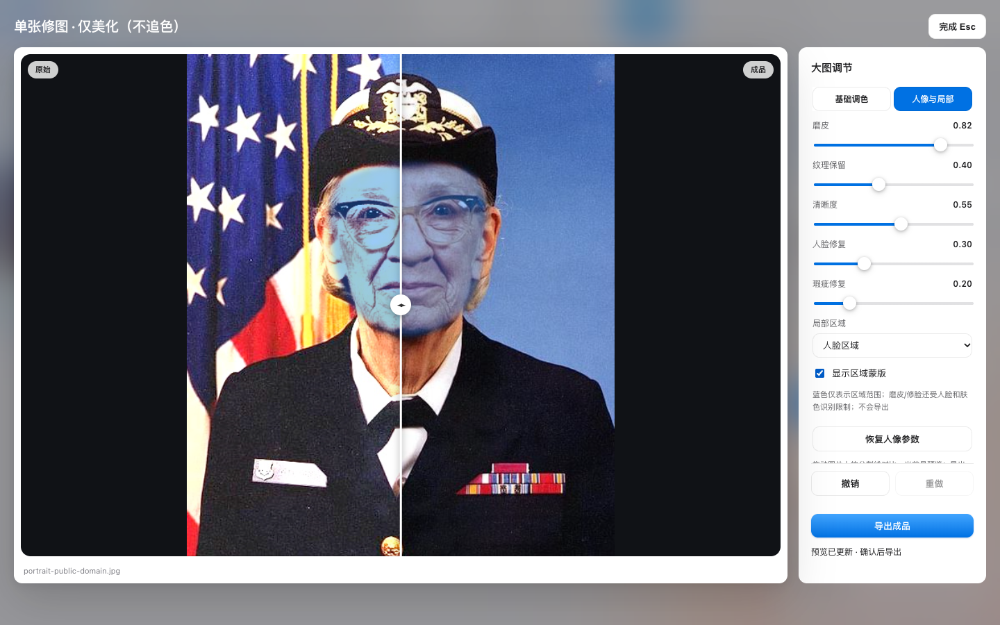
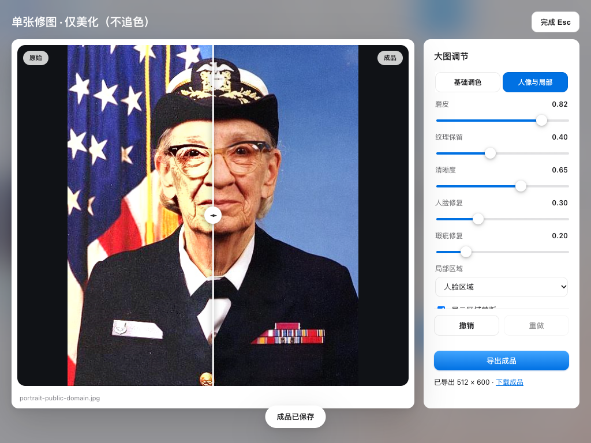
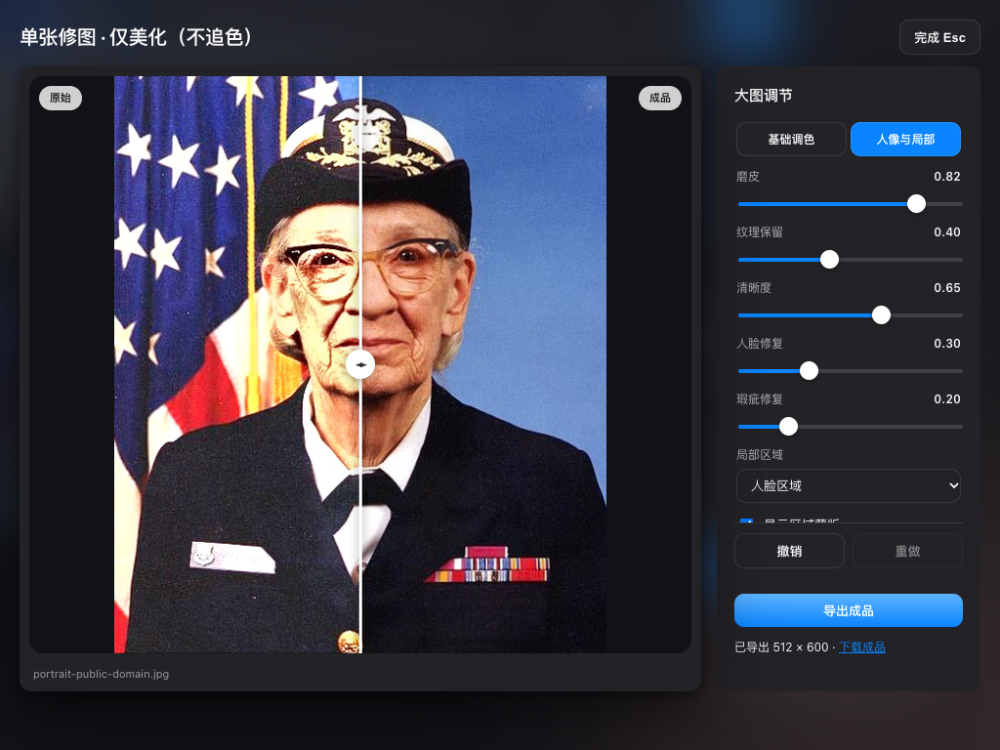
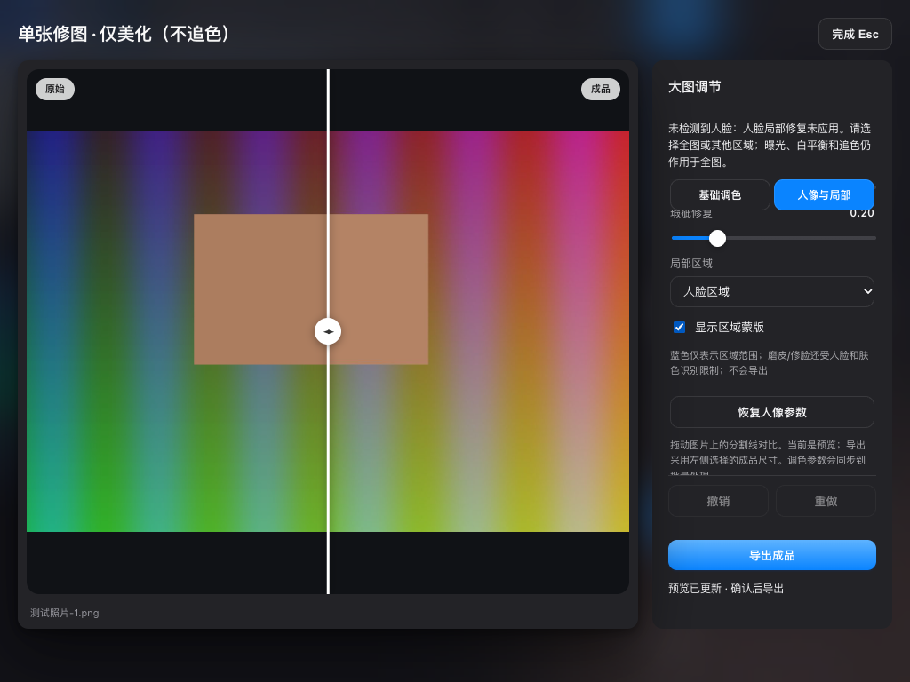
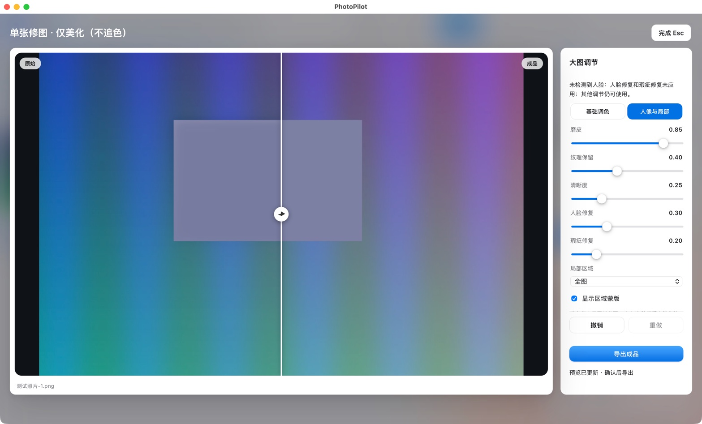
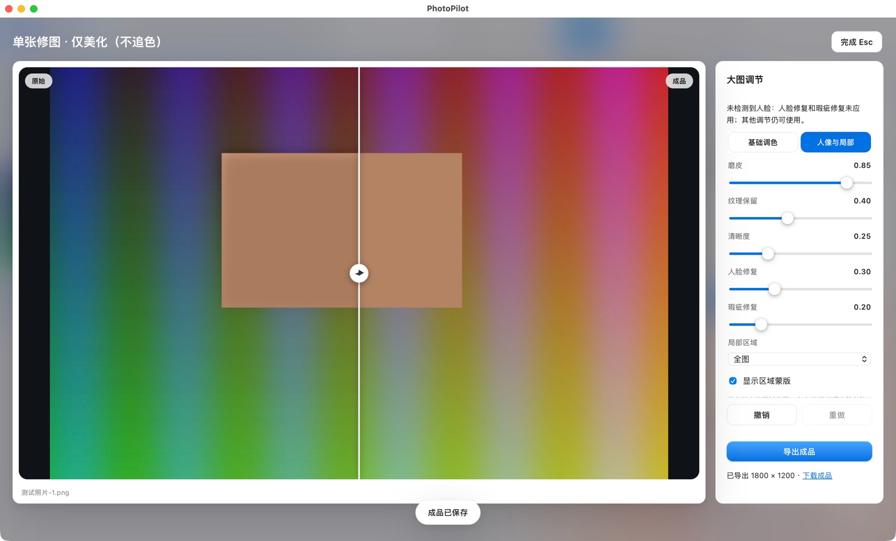

# 单张实时精修与区域蒙版验收

日期：2026-10-03。范围：单张人像调节、统一历史与草稿、区域叠层、预览/导出一致性及短窗口布局。
入口：http://127.0.0.1:18622；项目、导出记录、上传与缓存均隔离在临时目录。桌面端只使用代理自有 QA-EXPORT 测试照片。

## 结果

新增五项实时人像调节与区域选择，调色/人像分区，统一撤销与逐张草稿；蒙版只用于查看范围。功能实测通过，原图未改动。实现和验收过程中修补 5 项问题：4 项 Medium、1 项 Low；无本轮未解决的阻塞问题。

| 问题 | 严重度 / 类别 | 复现、预期与修补 |
|---|---|---|
| 旧蒙版位图可能盖在新预览上 | Medium / Functional | 延迟不同预览和 PNG 的加载、切换区域或关闭重开。仅判断响应版本或脱离 DOM 的预加载仍不足；现在同时检查编辑器身份、revision、renderEpoch、独立响应加载与显示图像自身加载，所有当前图像就绪才显示。失败、关闭或改参数立即隐藏旧叠层。 |
| 区域选择器获得焦点后快捷键撤销被跳过 | Medium / Functional | 改区域后焦点留在选择器，按 Cmd/Ctrl Z。原快捷键过滤所有 select；现在选择器和复选框焦点不再阻止编辑器统一撤销，文本输入仍保留其自身编辑行为。 |
| 小窗口滚动后参数页签不在可视区 | Medium / UX | 1024×768 滚动到人像区域与蒙版开关；页签原来随内容滚出。现在页签吸顶，撤销/导出固定在底部，诊断不随参数区滚动。 |
| 浅色主题参数文字对比度不足 | Medium / Accessibility | 实际浏览器颜色 rgb(124,124,130) / 白色未达到 4.5:1，新增断言先失败。仅覆盖编辑器次级文字：浅色 #636366 实测 5.99:1，深色 #aeaeb2 实测 7.08:1；全局配色、警告前景和禁用状态未改变。 |
| 导出结束恢复参数按钮的禁用状态不正确 | Low / Functional | 预先禁用人像恢复按钮，导出后应保留原禁用状态。现在按照导出前记录恢复，不被历史按钮更新覆盖。 |

## 回归与审核证据

- 基线：144 项 Python、82 项前端通过。本轮新增 14 项 Python、15 项前端；最终 158 + 97 = 255 项全部通过。
- 后端 RED：14 项新增测试暴露缺少覆写/蒙版接口及过晚校验（94 个子测试失败、1 个缺少参数错误）；补实现后 GREEN。严格拒绝非法键、字符串/布尔数值、NaN/Inf、越界及无效区域，且在图片解码前拒绝。
- 前端先以行为测试复现缺少人像控件/状态，再实现；额外解码竞态、区域快捷键和禁用恢复问题均先失败再修补。
- 真实像素单测验证五项参数、区域限定、tone+retouch 组合、不改变会话参数、空区域透明、RGBA 颜色/alpha/尺寸、唯一 URL、纯追色不跑人像及成品不生成蒙版。
- 前端覆盖手势合并、自动保存时仍是一条历史、50 状态上限、重做截断与回到原值、v2 原子验证、v1 迁移、逐张参数隔离、关闭/页面恢复、导出冻结与失败/旧响应/旧解码回调保护。
- 后端与前端均先独立规格审查再独立质量审查，未发现安全或逻辑阻塞；按本轮快照审核，不混入以前大量未提交修改。
- 最终独立集成审核通过，审查者再次运行 97 项前端回归全部通过；其文档措辞建议已修正。
- 新增生产行静态危险模式扫描无匹配；py_compile、git diff --check 通过。Impeccable detector 唯一提示为隐藏、动态赋值蒙版 img 没有初始 src；实际默认隐藏，只有完整加载后显示，不是可见的破损图片。

## 真实页面流程

使用复制的公有领域 Grace Hopper 人像，原照片仍在 demo/hopper.jpg，测试副本独立。

1. 通过真实文件输入导入照片，选择单张并打开美化；把磨皮设为 0.82、清晰度设为 0.55、人脸区域，打开蒙版。
2. 实际 PNG 为 512×600；人脸范围有 37,754 个非零 alpha 像素，269,446 个透明像素。叠层与适合画布的照片对齐，分割线可见；批量磨皮参数未被单张编辑改变。
3. 撤销区域回到全图、重做到人脸；改曝光并故意中断一次预览请求，旧蒙版隐藏，下一次调整成功重试。最终清晰度 0.65。
4. 关闭、显式保存、刷新页面、重开，恢复磨皮 0.82、清晰度 0.65、人脸区域；蒙版开关仍默认关闭。
5. 开着蒙版导出原始尺寸 JPEG；下载成功，最后预览 JPEG 与成品 JPEG 的 SHA256 完全相同。导出 prepare 使用最新人像参数，成品请求不传 show_mask，成品不含区域叠层。
6. 检查 1440×900、1024×768 浅色/深色：页签和导出按钮都在窗口内，面板没有横向溢出；文字对比度断言通过。
7. 再导入无人脸合成 PNG、选人脸区域、显示蒙版：alpha 全零，明确提示未检测到人脸。两类原始测试文件均未改动，页面 JavaScript 异常 0。

最终浏览器成品位于隔离目录：
`/private/tmp/photopilot-live-qa.a9oOhR/uploads/import-muru8yp1-6zt57j/photopilot_out/b95872f310ed/portrait-public-domain_pp.jpg`。

## 桌面验证

- 关闭前确认旧 PID 15551 的项目已保存、队列成功 3 / 失败 0 / 处理中 0；定向 Cmd+Q，确认旧主窗口及进程消失后才启动新版。
- 新版 PID 24529，PhotoPilot 主窗口 8223，原自有测试项目恢复 3 张、选中 1 张；应用清单只有这一 Python GUI 实例，PhotoPilot 主窗口只有一个。
- 点击美化→人像与局部→实际把单张磨皮从 0.60 改为 0.85→预览已更新；批量磨皮仍为 0.60。打开区域蒙版，蓝色叠层实际可见；点击导出，成功生成 1800×1200 PNG。
- 原图 SHA256 仍为 `d2a9a76d0291a0bb18f4944fc634050ffae66c48fe2b11398713a769cb44b3a0`。
- 桌面成品：`/Users/fanda./Pictures/PhotoPilot/QA-EXPORT-2026-10-01/photopilot_out/3f7ed85dd198/测试照片-1_pp.png`。最终保留新版大图及下载状态，独立 QA 服务已停止。
- 原生滑块的 AXValue/键盘调用没有触发页面更新，未当作成功；重新截图确认后，使用驱动的窗口内点击并检查参数、预览与导出才完成验收。

## 截图

## 已知边界与后续

- 浏览器控制台还有原有 `/favicon.ico` 404（Low / Console）；确认不是图片、成品或 API 失败。另一条 net::ERR_FAILED 是故意注入的请求中断，随后已恢复。没有据此宣称控制台完全零报错。
- 蒙版表示区域过滤范围，不是全部效果的精确作用强度；磨皮/修脸另受肤色与人脸检测限制。全局曝光、白平衡及追色保持原有范围。
- 未增加手动画笔、液化、生成式五官重建或新模型/第三方素材；未宣称已经达到像素蛋糕的完整商用质量。未验证真实婚礼整批、严重模糊/闭眼的修复品质。
- 人像参数逐张保存，不自动污染批量设置；现有 JSON 参数配方仍来自批量侧栏，不包含当前单张草稿或蒙版。
- 性能保护为复用本次已计算的区域蒙版、不重复检测，以及现有预览防抖/合并；本轮没有在 CPU 并发负载下给出速度提升百分比。
- 未运行会改写 demo 的 tests/run_all.py，未提交、推送、清空用户目录或覆盖既有改动。

方法：systematic-debugging 确定失效边界；test-driven-development 先失败再实现；writing-plans/subagent-driven-development 分步独立审查；impeccable harden/craft-floor 规范分区、短窗口和对比度；dogfood 真正走完操作；cua-driver 检查桌面结果；requesting-code-review 增量审核。
