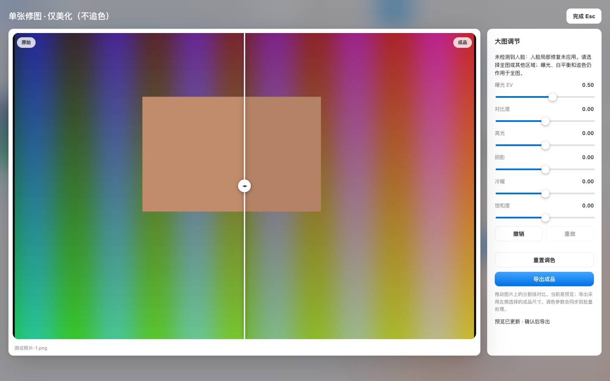
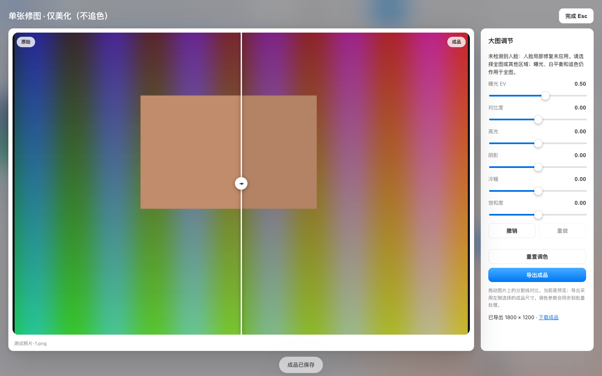
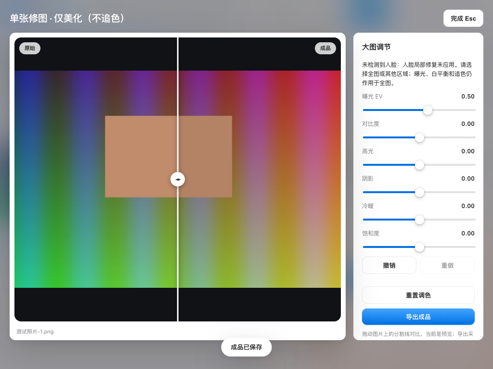
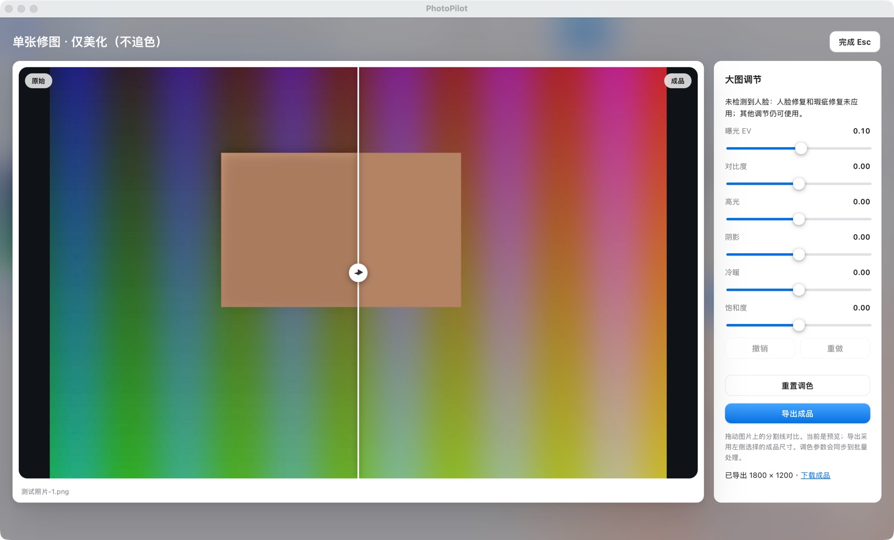

# 单张局部修复审核与实测

日期：2026-10-03。范围：眼睛区域回退、未应用局部修复的反馈、单张预览/导出及短窗口布局。
测试入口：http://127.0.0.1:18621（独立临时服务；项目、导出记录、上传与缓存全部隔离）。

## 结果

本轮 4 项问题均修补并验证：1 项 High / Functional，2 项 Medium / UX，1 项 Low / Functional。未发现本轮新增的阻塞问题。

| 问题 | 严重度 / 类别 | 复现、预期与修补 |
|---|---|---|
| 眼睛区域在没有关键点时是空蒙版 | High / Functional | 普通人脸框或 FaceInfo(mesh=False)，选择眼睛并提高局部清晰度。原实现蒙版全零、调整无效；现在回退到已有 OpenCV Haar 眼部检测并羽化，仅影响检测区域。 |
| 未检测到局部区域仍只显示“预览已就绪” | Medium / UX | 导入无人脸合成照片、选择人脸区域、美化。现在明确提示人脸局部修复未应用，说明全局曝光/白平衡/追色仍可生效；预览更新与导出都保留当前诊断。 |
| 短窗口诊断在滑杆下方被裁切 | Medium / UX | 1024×768 单张精修面板；首次截图发现提示在底部需要滚动。现在提示位于标题下、滑杆前，使用前景色与 12px 字号；实测整个提示框处于面板可视范围，横向不溢出。 |
| 完全在图外的负坐标人脸框仍触发眼睛检测 | Low / Functional | 人脸框 (-20,10,15,30)。原负切片会取得意外图像区域；现在跳过无有效交集的框，并裁剪部分越界眼睛框。 |

## 验证证据

- 修改前基线：137 项 Python、79 项前端测试通过。
- 新增测试先复现空蒙版、无诊断及负坐标切片错误；UI 位置测试先失败，再移到顶部通过。
- 修改后：144 项 Python、82 项前端测试全部通过。
- 新增覆盖：真实像素的局部修改与区域外不变；无眼睛时图像不变且提示；一次定位复用于蒙版/提亮；FaceInfo 无关键点；完全/部分越界；诊断安全纯文本、旧预览不覆盖新导出诊断、后续无警告时清除旧提示。
- 实际页面流程：通过文件输入导入 1 张合成 PNG → 人脸区域 → 美化大图 → 改曝光 → 更新预览 → 导出 → 下载返回 HTTP 200；非模拟 API/渲染/人脸检测。原始测试文件 SHA256 不变，页面 JavaScript 异常 0。
- 1440×900 与 1024×768 截图检查；后者检查提示框全可见及无横向溢出。
- 桌面程序：先核实旧 PhotoPilot 队列已完成（3 成功、0 失败、0 处理中），通过定向 Cmd+Q 关闭 PID 25148；后台启动新实例 PID 15551，核实只存在一个 PhotoPilot 主窗口（8118）。原项目恢复正常，未启动重复实例。
- 桌面端再次只选测试照片-1.png → 点击美化 → 大图显示未检测到人脸提示 → 点击导出成品，实际得到 1800×1200 PNG：`/Users/fanda./Pictures/PhotoPilot/QA-EXPORT-2026-10-01/photopilot_out/592392a46820/测试照片-1_pp.png`。原测试图 SHA256 仍为 d2a9a76d0291a0bb18f4944fc634050ffae66c48fe2b11398713a769cb44b3a0。
- 独立增量代码审核通过（无安全或逻辑阻塞意见）；按本轮快照比较，不与大量既有未提交改动混淆。
- 新增生产行静态危险模式扫描无匹配，py_compile、git diff --check 通过；Impeccable detector 返回空列表。

截图：

## 覆盖边界与注意事项

- 眼部回退的精确定位/裁剪使用确定性检测结果测试；实际页面验证使用无人脸合成图。未据此宣称真实婚礼照片、闭眼或严重模糊的修复质量已达到商用精修软件。
- 未加入画笔、生成式五官重建、新模型权重或第三方滤镜素材。全局曝光与白平衡的既有行为保留。
- 本轮诊断显示于单张编辑器；后台批量任务逐项诊断展示尚未扩展。
- 既有磨皮/修脸参数仍在打开编辑器前设定，撤销栈仍只覆盖六项基础调色，未伪装成完整局部编辑历史。
- 首次实测脚本下载使用相对 URL 导致测试端报 Invalid URL，修正为绝对 URL 后通过；重复测试恢复了曝光值，设相同值不会触发预览，改为实际改变值后通过。这些是测试脚本问题，不计为产品 bug。
- 测试使用独立临时数据，未运行会改写 demo 产物的 tests/run_all.py，未改动用户原图、未提交或推送。
- 桌面端只使用上轮由代理生成的 QA-EXPORT 测试目录；最终保留一个更新后的 PhotoPilot 窗口，大图里可直接看到本轮提示与已导出状态。独立测试服务已停止。

方法：systematic-debugging 先确定根因；test-driven-development 先失败再修补；impeccable harden 规范将无效操作反馈放在可见位置并提升可读性；dogfood 实际走通用户路径；requesting-code-review 独立审核增量。
